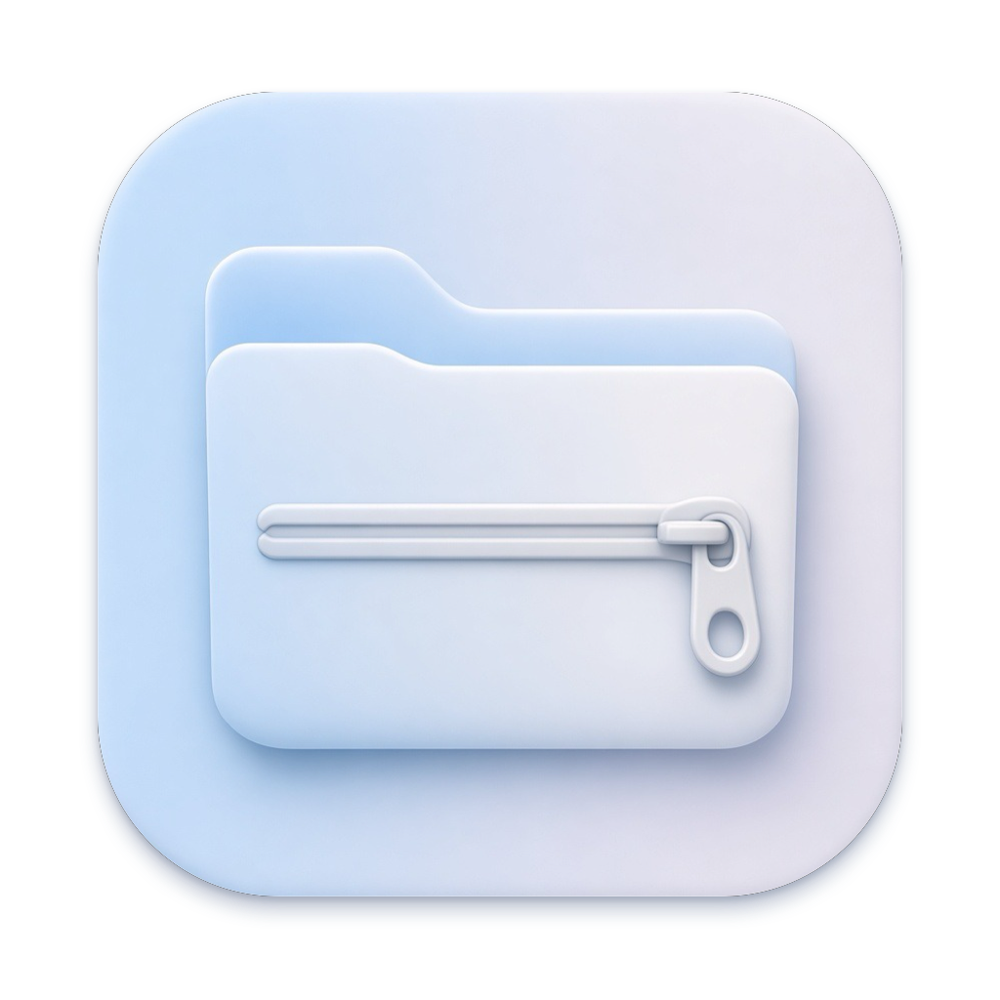
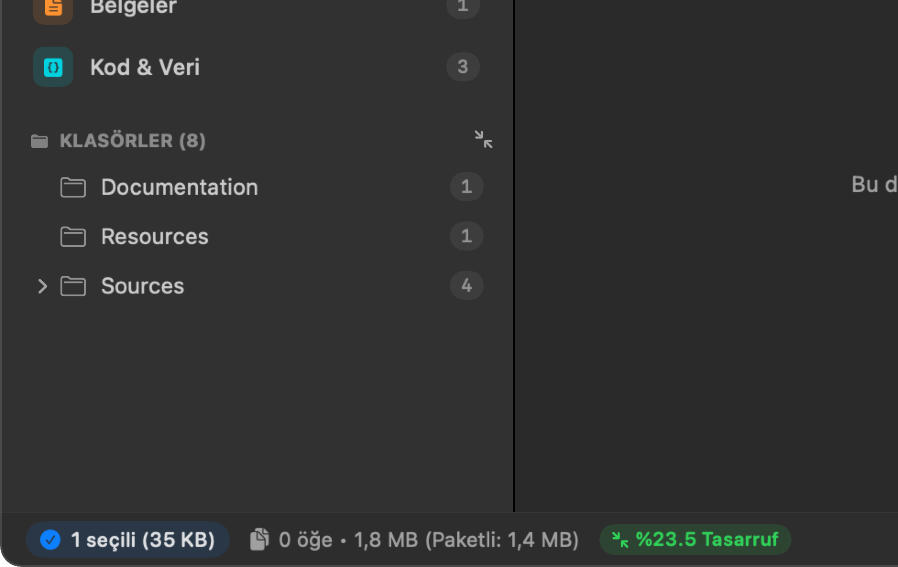
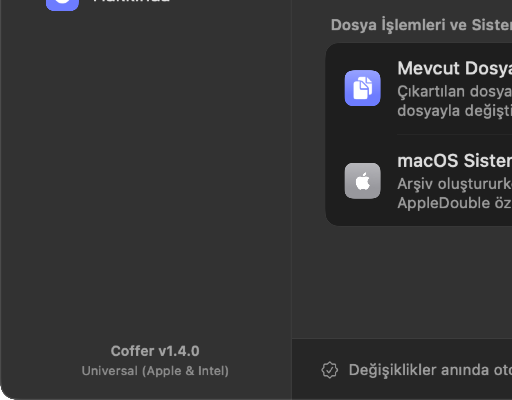
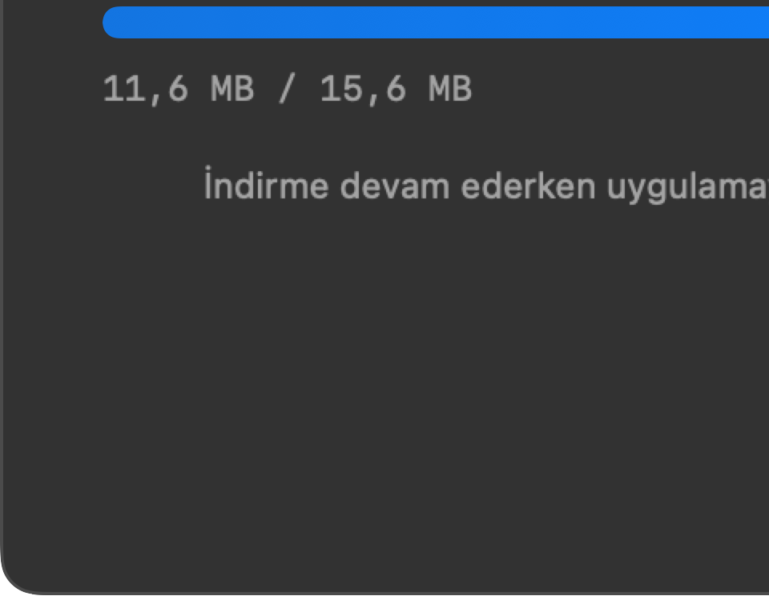
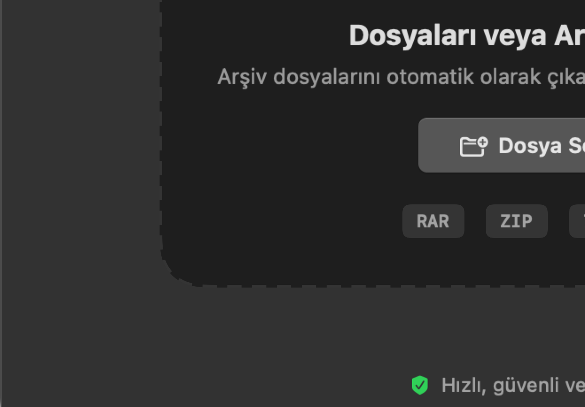

  
  <h1>Coffer</h1>
  
<strong>macOS için hızlı, sade ve güvenli arşiv yöneticisi.</strong>

  

    
    
    
    
  

---

Coffer; macOS işletim sisteminin modern tasarım diline sadık kalınarak saf Swift ve SwiftUI ile geliştirilmiş bir arşiv yönetim aracıdır. 

ZIP, RAR, 7Z ve TAR arşivlerini diske çıkarmadan incelemenizi, aradığınız dosyaları Quick Look ile anında önizlemenizi, masaüstünüzü dağıtmadan dosyalarınızı ayıklamanızı ve güvenli yeni arşivler oluşturmanızı sağlar.

Apple Silicon (M1–M4) ve Intel işlemcili Mac bilgisayarlarda yerel (Universal Binary) hızda çalışır; arka planda sistem kaynaklarını tüketmeden akıcı bir deneyim sunar.

---

## Öne Çıkan Özellikler

### 🗂️ Arşiv Gezgini ve Önizleme
* **Çıkarmadan İnceleme:** Arşivi diske açmaya gerek kalmadan klasör hiyerarşisinde rahatça dolaşın.
* **Quick Look Desteği:** Boşluk (`Space`) tuşuna basarak metinleri, kodları, PDF'leri ve görselleri anında önizleyin.
* **İki Farklı Görünüm:** Tercihinize göre Finder tarzı simge (ızgara) görünümü veya ayrıntılı liste görünümü arasında tek tıkla geçiş yapın.
* **Anında Arama:** `⌘F` kısayoluyla arşiv içindeki yüzlerce dosya arasında gecikmesiz filtreleme yapın.

### 🖱️ Doğrudan Finder Entegrasyonu
* Finder üzerinde herhangi bir dosyaya veya arşive sağ tıkladığınızda Coffer eylemleri doğrudan ana menüde listelenir:
  * **Buraya Çıkart**
  * **Klasöre Çıkart**
  * **Coffer ile Aç ve İncele**
  * **Hızlı .ZIP / .RAR / .7Z Sıkıştır**
  * **Coffer ile Arşivle...** (Gelişmiş seçenekler)

### 🛡️ Otomatik Klasörleme (Dağılma Koruması)
* Arşivin içinde tek bir ana klasör yoksa ve dosyalar kök dizine yayılmışsa, Coffer masaüstünüzün dağılmasını engellemek için otomatik olarak arşiv adında bir klasör oluşturur ve dosyaları içine yerleştirir.
* Arşiv zaten tek bir klasör içeriyorsa fazladan iç içe klasör yaratmaz.

### 🔒 Güvenlik ve Şifreleme
* **AES-256 Güvenliği:** Arşivlerinizi güçlü parolalarla şifreleyin. İsteğe bağlı olarak dosya adlarını da gizleyerek tam gizlilik sağlayın.
* **Zararlı Dosya Taraması:** Güvensiz betikleri, gizli yürütülebilir dosyaları ve dizin aşımı (Zip Slip) açıklarını arşiv açılmadan önce tespit eder.
* **Bütünlük Doğrulaması:** Arşivin bozulup bozulmadığını sağlama toplamları (CRC32/SHA) üzerinden tek tıkla test edin.

### ⚙️ Sade Arşiv Oluşturma
* Ekrana tam sığan, kaydırma gerektirmeyen şık tasarım.
* Sıkıştırma düzeyini ayarlayın (Depola, Hızlı, Normal, En İyi).
* `.DS_Store` ve `__MACOSX` gibi gereksiz macOS sistem artıklarını tek dokunuşla arşivden temizleyin.
* Büyük dosyaları e-posta veya harici diskler için ciltlere (parçalara) bölün.

### 🔄 Format Dönüştürme ve Karşılaştırma (Diff)
* Mevcut bir arşivi diske açıp tekrar sıkıştırmakla uğraşmadan doğrudan başka bir formata (örneğin RAR'dan ZIP veya 7Z'ye) dönüştürün.
* İki arşiv dosyasını yan yana koyarak eklenen, silinen ve değiştirilen dosyaları karşılaştırın.

---

## Ekran Görüntüleri

  
<strong>Arşiv Gezgini (Finder Tasarımlı Liste ve Hızlı Önizleme)</strong>

  
    

| Ayarlar ve Tercihler | Canlı Sürüm Güncelleyici |
| :---: | :---: |
|  |  |

   
  
<strong>Hızlı Dosya Bırakma Alanı</strong>

  
   

---

## Desteklenen Formatlar

| Format | İnceleme | Çıkartma | Oluşturma |
| :--- | :---: | :---: | :---: |
| **ZIP (.zip, .zipx)** | Evet | Evet | Evet |
| **RAR (.rar, .cbr)** | Evet | Evet | Evet *(RAR for macOS ile)* |
| **7-Zip (.7z, .cb7)** | Evet | Evet | Evet |
| **TAR (.tar, .tar.gz, .tgz, .tar.bz2, .tar.xz)** | Evet | Evet | Evet |
| **Çok Parçalı Arşivler (.part1.rar, .001, .z01)** | Evet | Evet | Evet |
| **Disk Görüntüleri (.iso)** | Evet | Evet | — |

---

## Sistem Gereksinimleri

* **İşletim Sistemi:** macOS 14.0 (Sonoma), macOS 15.0 (Sequoia) veya üzeri
* **İşlemci Mimarisi:** Apple Silicon (M1 / M2 / M3 / M4) veya Intel x86_64

---

## Kurulum

1. En son sürüm yükleyicisini (`Coffer-1.6.0.dmg`) **[Releases](https://github.com/blackowltr/Coffer/releases)** sayfasından veya **[Web Sitemizden](https://blackowltr.github.io/Coffer/)** indirin.
2. DMG dosyasını açıp `Coffer` simgesini `Uygulamalar` (Applications) klasörüne sürükleyin.
3. Uygulamayı ilk kez açtığınızda gerekli sistem izinleri onaylanır; ardından Coffer arka planda sessizce ve kesintisiz şekilde çalışmaya devam eder.

---

## Gizlilik ve Güvenlik

Coffer tamamen yerel olarak çalışır:
* Telemetri, analiz veya kullanıcı davranışı takibi yapmaz.
* Dosyalarınız hiçbir zaman harici bir sunucuya iletilmez; tüm arşivleme ve şifreleme işlemleri kendi bilgisayarınızda gerçekleşir.
* Açık kaynak kodludur ve MIT lisansı ile korunur.

---

## Lisans

Bu proje [MIT Lisansı](LICENSE) kapsamında sunulmaktadır.
